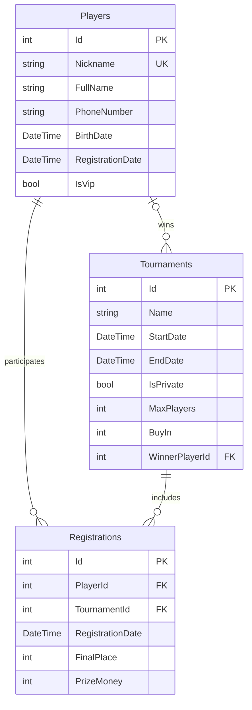

# Poker Club
приложение для регистрации игроков на покерные турниры и отслеживания их результатов и рейтинга среди участников клуба

**Вашедская Нина ; РПО 1 / 24**

тема - игральное заведение ;
название - покерный клуб **«комната» («KOMNATA»)** ;
приложение предназначено для удобства сотрудников и гостей клуба - администраторы регистрируют новых игроков, участники регистрируются на предстоящие турниры, просматривают результаты прошедших и отслеживают свой рейтинг ;
приложение дает возможность объединить информацию об игроках, турнирах и результатах их участия в единой системе

**схема БД**

на схеме:

* PK - первичный ключ (Primary Key)
* FK - внешний ключ (Foreign Key)
* UK - уникальное поле (Unique Key)

**таблицы БД**

1 Players - игроки (содержит информацию о зарегестрированных участников покерного клуба)

| поле | тип | not null | описание |
|---|---|---|---|
| Id | int | да | уникальный идентификатор игрока |
| Nickname | string | да | игровой псевдоним |
| FullName | string | да | ФИО игрока |
| PhoneNumber | string | да | номер телефона |
| BirthDate | DateTime | да | дата рождения |
| RegistrationDate | DateTime | да | дата регистрации |
| IsVip | bool | да | наличие VIP-статуса |

2 Tournaments - турниры (содержит информацию о проводимых турнирах)

| поле | тип | not null | описание |
|---|---|---|---|
| Id | int | да | уникальный идентификатор турнира |
| Name | string | да | название турнира |
| StartDate | DateTime | да | дата и время начала турнира |
| EndDate | DateTime | нет | дата и время окончания турнира |
| IsPrivate | bool | да | является ли турнир закрытым |
| MaxPlayers | int | да | максимальное количество участников |
| BuyIn | int | да | стоимость участия в рублях |
| WinnerPlayerId | int | нет | идентификатор игрока-победителя |

3 Registrations - регистрации (таблица связывает игроков с турнирами и содержит информацию об участии и результатах игроков)

| поле | тип | not null | описание |
|---|---|---|---|
| Id | int | да | уникальный идентификатор регистрации |
| PlayerId | int | да | идентификатор зарегистрированного игрока |
| TournamentId | int | да | идентификатор турнира |
| RegistrationDate | DateTime | да | дата регистрации на турнир |
| FinalPlace | int | нет | итоговое место игрока в турнире |
| PrizeMoney | int | нет | размер выигранного приза в рублях |

**связи между таблицами** 

* Players и Registrations : связь один-ко-многим ; один игрок может зарегистрироваться на несколько турниров, каждая регистрация относится к одному игроку ; связь осуществляется через внешний ключ PlayerId
* Tournaments и Registrations : связь один-ко-многим ; в одном турнире может участвовать несколько игроков, каждая регистрация относится к одному турниру ; связь осуществляется через внешний ключ TournamentId
* Players и Tournaments : дополнительная связь через поле WinnerPlayerId, она позволяет указать игрока, победившего в конкретном турнире ; у турнира может быть не более одного победителя, один игрок может выиграть несколько турниров

таким образом, таблицы Players и Tournaments связаны отношением многие-ко-многим через промежуточную таблицу Registrations : один игрок может участвовать в нескольких турнирах, в одном турнире могут участвовать несколько игроков
